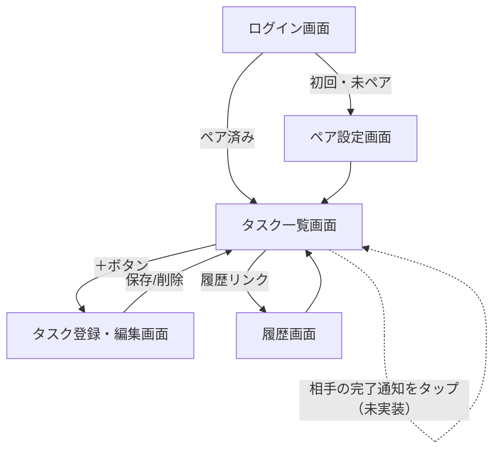

# kaji-share 設計書（MVP）

対象: 夫婦2人で使う家事タスク管理アプリ

### コンセプト
毎日系の家事（食器洗い・ゴミ出しなど）は、その日の状況次第でどちらがやるか自然に決まるため、割り振っても意味が薄い＝対象外とする。
本アプリは「定期的にやらないといけないが、忘れがちな家事」（フィルター掃除・資源ごみ出しなど）を可視化し、夫婦で分担・管理することにフォーカスする。

MVPスコープ: 「登録 → チェック → 通知」のコアループのみ。ご褒美・メッセージ/スタンプ・月末振り返りは次フェーズ。

---

## ① 機能概要

### MVPでやること
- [実装済み] 家事タスクを登録する（タイトル／担当者／頻度：毎週・毎月）
- [実装済み] 今週・今月のタスク一覧を見る
- [実装済み] タスクにチェックをつけて完了にする
- [未実装] 相手がタスクを完了したら、もう一方に通知が届く

### MVP後に追加した機能
- [実装済み] タスクの削除（一覧・編集画面の両方から。実施済みタスクは警告メッセージを表示）
- [実装済み] タスクの保留（`isPaused`）。データ・履歴は残したまま、チェック不可にして一覧の下部に表示
- [実装済み] 履歴画面（実施状況タブ：各タスクの最終実施日／月別タブ：タスク×直近1年の月を行列表示し、実施済みセルをタップすると実施日一覧をモーダル表示）
- [実装済み] 招待コードのコピー機能
- [実装済み] タスク一覧の「すべて」タブ（週次・月次をまとめて表示）、「自分のタスクのみ」フィルタ

### 次フェーズ（今回は作らない）
- 完了通知（Firebase Cloud Messaging）— MVPスコープだが未着手。次に着手予定
- 目標達成時のご褒美登録・達成判定
- 完了時にメッセージ／スタンプを送り合う
- 月末振り返り機能
  - 振り返り日（毎月1回）を登録できる
  - 振り返り日に通知を飛ばす
  - 先月のタスク状況を最低限確認できる
- 配布方法: iPhone側はWeb版（Safariでホーム画面に追加）、Android側はスタンドアロンアプリ（EAS Buildで.apkをビルドしてインストール）とする
  - iOSのApple Developer Program登録（年$99）を避けるための判断
  - 通知の仕組みがOSごとに分かれる点に注意: Android → expo-notifications(FCM)、iOS(Web) → Web Push（別実装が必要。まずはAndroid側のみ通知を実装し、iOS側は手動確認から始める案もあり）

### 想定ユーザー
- 夫婦2人のみ。招待コードでペアを組む、クローズドな2人用アプリ。

---

## ② システム構成（簡易）

- フロントエンド: React Native (Expo) — iPhone側はWeb版（Firebase Hostingで配信）、Android側はスタンドアロンアプリ（EAS Buildで.apkをビルド）
- バックエンド: Firebase
  - Auth: メールアドレス＋パスワード認証
  - Firestore: タスク・ユーザー・ペア情報の保存
  - Hosting: Web版（iPhone向け）の配信
  - Cloud Messaging (FCM): 完了通知のプッシュ送信（未実装、次フェーズ）
- 通知の流れ（未実装。実装時はこの構成を想定）: タスク完了 → Firestoreのタスクを更新 → Cloud Functionsがトリガーされ、相手のデバイスにFCM通知を送信

```mermaid
flowchart LR
    subgraph App[Expoアプリ (iOS/Android)]
        UI[画面]
    end
    UI -- 読み書き --> Auth[Firebase Auth]
    UI -- 読み書き --> FS[(Firestore)]
    FS -- タスク完了を検知 --> CF[Cloud Functions]
    CF -- プッシュ通知 --> FCM[Firebase Cloud Messaging]
    FCM -- 通知 --> Partner[相手の端末]
```

---

## ③ 機能詳細

### 画面一覧

| 画面 | 概要 |
|---|---|
| ログイン画面 | メールアドレス＋パスワードでログイン／新規登録 |
| ペア設定画面 | 招待コードを発行/入力してパートナーと紐付け（初回のみ）。発行したコードはコピー可能 |
| タスク一覧画面 | 今週/今月/すべてを切り替えてタスクを表示。チェックで完了操作、削除、自分のタスクのみ表示フィルタ |
| タスク登録・編集画面 | タイトル・担当者（自分/相手/どちらでも）・頻度を設定。保留のオン/オフ、削除もここから |
| 履歴画面 | 実施状況タブ（各タスクの最終実施日）／月別タブ（タスク×直近1年の月を行列表示。週次タスクはその月に1回でも実施していれば✔️、セルをタップすると実施日一覧をモーダル表示） |

### 画面遷移図



---

## ④ データモデル設計（Firestore）

```
users/{uid}
  - name: string
  - coupleId: string | null   // 所属するペアのID（未ペアはnull）
  - pushToken: string | null  // FCM通知用トークン（未実装）

couples/{coupleId}
  - memberUids: [uid, uid]    // 夫婦2人分
  - inviteCode: string        // ペアリング用の招待コード

couples/{coupleId}/tasks/{taskId}
  - title: string             // 例: "換気扇フィルター掃除"
  - assigneeUid: string | null  // null = どちらでもOK
  - frequency: "weekly" | "monthly"
  - isPaused: boolean         // 保留中はチェック不可・一覧の下部に表示
  - completions: {            // キー: 週次は"2026-W37"、月次は"2026-09"のような期間キー
      [periodKey: string]: {
        completedBy: uid
        completedAt: timestamp
      }
    }
  - createdAt: timestamp      // タスク登録日時。履歴の月別マトリクスで登録前の月を判別するために使用
  - updatedAt: timestamp
```

補足:
- タスクは「ペア共有」の1コレクションに置き、担当者はフィールドで表現（夫婦共同達成型のため、どちらから見ても同じ一覧が見える）。
- 「今の期間で完了しているか」は、`completions`に現在の期間キー（週次はISO週番号、月次は年月）が存在するかで判定する。期間が変われば自動的に未完了扱いに戻るため、リセット用のバッチ処理は不要。
- `completions`は削除されずに蓄積されるため、そのまま完了履歴（履歴画面）としても使う。タスク自体を削除すると履歴もまとめて消える点に注意。
- タスクを削除すると`isPaused`を含めタスクドキュメントごと消えるため、「やめるか迷う」タスクは削除せず`isPaused`をtrueにして保留する運用を想定。

---

## 他に決めておくと良さそうな点（提案）

- 通知に「多すぎて煩わしい」を防ぐため、通知するタイミングを絞る（完了時のみ、リマインドは今回なし）
