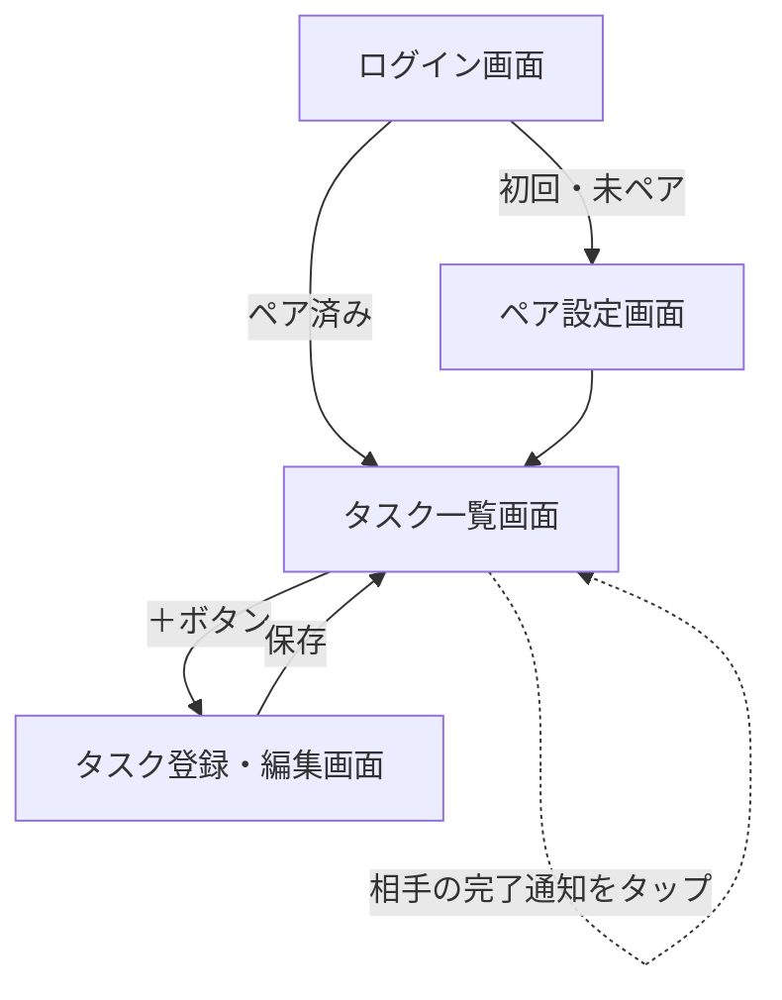

# kaji-share 設計書（MVP）

対象: 夫婦2人で使う家事タスク管理アプリ

### コンセプト
毎日系の家事（食器洗い・ゴミ出しなど）は、その日の状況次第でどちらがやるか自然に決まるため、割り振っても意味が薄い＝対象外とする。
本アプリは「定期的にやらないといけないが、忘れがちな家事」（フィルター掃除・資源ごみ出しなど）を可視化し、夫婦で分担・管理することにフォーカスする。

MVPスコープ: 「登録 → チェック → 通知」のコアループのみ。ご褒美・メッセージ/スタンプ・月末振り返りは次フェーズ。

---

## ① 機能概要

### MVPでやること
- [実装済み] 家事タスクを登録する（タイトル／担当者／頻度：毎週・毎月）
- [実装済み] 今週・今月のタスク一覧を見る
- [実装済み] タスクにチェックをつけて完了にする
- [未実装] 相手がタスクを完了したら、もう一方に通知が届く

### 次フェーズ（今回は作らない）
- 完了通知（Firebase Cloud Messaging）— MVPスコープだが未着手。次に着手予定
- 目標達成時のご褒美登録・達成判定
- 完了時にメッセージ／スタンプを送り合う
- 月末振り返り機能
  - 振り返り日（毎月1回）を登録できる
  - 振り返り日に通知を飛ばす
  - 先月のタスク状況を最低限確認できる
- 配布方法: iPhone側はWeb版（Safariでホーム画面に追加）、Android側はスタンドアロンアプリ（EAS Buildで.apkをビルドしてインストール）とする
  - iOSのApple Developer Program登録（年$99）を避けるための判断
  - 通知の仕組みがOSごとに分かれる点に注意: Android → expo-notifications(FCM)、iOS(Web) → Web Push（別実装が必要。まずはAndroid側のみ通知を実装し、iOS側は手動確認から始める案もあり）

### 想定ユーザー
- 夫婦2人のみ。招待コードでペアを組む、クローズドな2人用アプリ。

---

## ② システム構成（簡易）

- フロントエンド: React Native (Expo) — iOS/Androidアプリ
- バックエンド: Firebase
  - Auth: ログイン（メール認証 or Googleログイン）
  - Firestore: タスク・ユーザー・ペア情報の保存
  - Cloud Messaging (FCM): 完了通知のプッシュ送信
- 通知の流れ: タスク完了 → Firestoreのタスクを更新 → Cloud Functionsがトリガーされ、相手のデバイスにFCM通知を送信

```mermaid
flowchart LR
    subgraph App[Expoアプリ (iOS/Android)]
        UI[画面]
    end
    UI -- 読み書き --> Auth[Firebase Auth]
    UI -- 読み書き --> FS[(Firestore)]
    FS -- タスク完了を検知 --> CF[Cloud Functions]
    CF -- プッシュ通知 --> FCM[Firebase Cloud Messaging]
    FCM -- 通知 --> Partner[相手の端末]
```

---

## ③ 機能詳細

### 画面一覧

| 画面 | 概要 |
|---|---|
| ログイン画面 | メール or Googleでログイン |
| ペア設定画面 | 招待コードを発行/入力してパートナーと紐付け（初回のみ） |
| タスク一覧画面 | 今週/今月を切り替えてタスクを表示。チェックで完了操作 |
| タスク登録・編集画面 | タイトル・担当者（自分/相手/どちらでも）・頻度を設定 |

### 画面遷移図



---

## ④ データモデル設計（Firestore）

```
users/{uid}
  - name: string
  - coupleId: string          // 所属するペアのID
  - pushToken: string         // FCM通知用トークン

couples/{coupleId}
  - memberUids: [uid, uid]    // 夫婦2人分
  - inviteCode: string        // ペアリング用の招待コード

couples/{coupleId}/tasks/{taskId}
  - title: string             // 例: "洗い物"
  - assigneeUid: string | null  // null = どちらでもOK
  - frequency: "weekly" | "monthly"
  - status: "pending" | "done"
  - completedBy: uid | null
  - completedAt: timestamp | null
  - updatedAt: timestamp
```

補足:
- タスクは「ペア共有」の1コレクションに置き、担当者はフィールドで表現（夫婦共同達成型のため、どちらから見ても同じ一覧が見える）。
- 頻度ごとの「期間内で完了したか」は、`status`をタスクの周期（日/週/月）に合わせてバッチ処理でリセットする想定（Cloud Functionsで定期実行）。

---

## 他に決めておくと良さそうな点（提案）

- 通知に「多すぎて煩わしい」を防ぐため、通知するタイミングを絞る（完了時のみ、リマインドは今回なし）
- ペアリング方法は招待コード方式で確定してよいか
